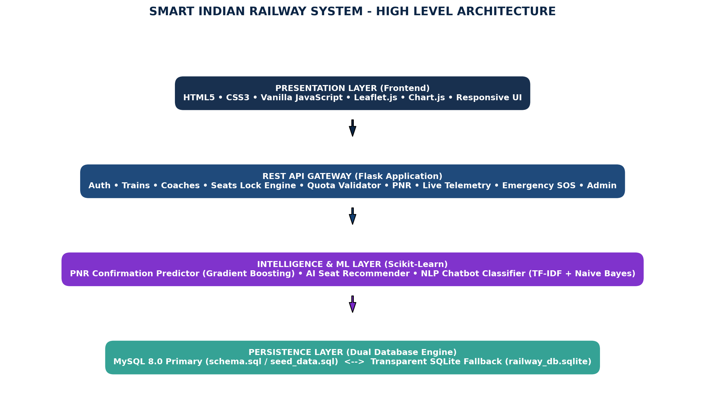

# Smart Indian Railway Ticket Reservation System

A full-stack, production-style, modern Indian Railway web application engineered with Python Flask, MySQL, Scikit-Learn machine learning models, and a modern responsive user interface.



---

## Key Highlights & Features

- **Interactive Coach Seat Layouts:** Realistic berth maps for **3A**, **2A**, **Sleeper (SL)**, and **AC Chair Car (CC)** with compartment bays, gangway/aisle corridors, and individual berth designations (Lower, Middle, Upper, Side Lower, Side Upper).
- **Active Seat Locking Engine:** Prevents double-booking with concurrency locks, a 5-minute countdown timer, and automatic expiry cleanup.
- **AI Seat Recommender:** Multi-attribute explainable heuristic model optimizing window views, lower berths for senior citizens, and low-traffic central coach compartments.
- **AI PNR Confirmation Predictor:** Gradient Boosting ML model trained on 2,000+ historical railway bookings to calculate calibrated confirmation probabilities for waitlisted tickets.
- **Live GPS Train Tracking:** Animated moving train marker, station waypoints, polyline route tracking, live speedometer, and next station ETA on Leaflet.js maps.
- **AI Railway Assistant Chatbot:** Natural language intent classification (TF-IDF + Multinomial Naive Bayes) handling PNR queries, train searches, quota rules, and instant actions.
- **Emergency SOS & RPF-139 Protocol:** High-visibility emergency dispatch system with incident ID generation, live status tracking, and simulated control room alerts.
- **Executive Admin Dashboard:** Real-time KPI cards, Chart.js trends (Daily bookings, Revenue, Class occupancy, Quota share, Delay distribution), and CRUD controls for trains, bookings, and emergencies.
- **Dual Database Architecture:** Native MySQL 8.0 support with automatic, transparent fallback to local SQLite (`railway_db.sqlite`) with auto-seeded data for effortless zero-configuration local runs.

---

## Technology Stack

| Layer | Technologies |
| :--- | :--- |
| **Frontend** | HTML5, CSS3, Vanilla JavaScript (ES6+), Leaflet.js 1.9, Chart.js 4.4, FontAwesome 6 |
| **Backend** | Python 3, Flask 3.1, Flask-CORS, Werkzeug (Scrypt password hashing) |
| **Database** | MySQL 8.0+ / SQLite 3 transparent fallback, Parameterized SQL queries |
| **Machine Learning** | Scikit-Learn, NumPy, Pandas, Joblib (Gradient Boosting & Naive Bayes) |
| **Data Analytics** | Pandas, Seaborn, Matplotlib, Jupyter Notebooks |

---

## Quick Start (Zero-Configuration Demo)

You can launch and test the entire system right away:

```bash
# 1. Clone or navigate to the project directory
cd railway-ticket-system

# 2. Install dependencies
pip install -r backend/requirements.txt

# 3. Launch the application
python run.py
```

Then open your browser at:
👉 **[http://127.0.0.1:5000](http://127.0.0.1:5000)**

---

## Database Setup (MySQL Configuration)

If you have MySQL running locally and want to use it as the primary database:

1. Log in to your MySQL terminal or Workbench:
   ```bash
   mysql -u root -p
   ```
2. Create and seed the database:
   ```sql
   SOURCE database/schema.sql;
   SOURCE database/seed_data.sql;
   ```
3. Create a `.env` file in the project root:
   ```env
   DB_TYPE=mysql
   DB_HOST=localhost
   DB_PORT=3306
   DB_USER=root
   DB_PASSWORD=your_password
   DB_NAME=railway_db
   SECRET_KEY=smart-railway-jwt-secret-key-2026
   ```
4. Restart Flask:
   ```bash
   python run.py
   ```

*(Note: If MySQL is not running or credentials fail, the system automatically uses SQLite with all data pre-populated without crashing!)*

---

## Demo Credentials & Sample PNRs

### Demo Accounts
| Role | Email | Password |
| :--- | :--- | :--- |
| **Administrator** | `admin@railway.gov.in` | `Admin@12345` |
| **Passenger User** | `rahul.sharma@example.com` | `User@12345` |
| **Passenger User** | `priya.patel@example.com` | `User@12345` |

### Sample PNRs
- `2846190532` — **CONFIRMED** (New Delhi to Mumbai Central, Coach B1-1)
- `4198273641` — **RAC** (Reservation Against Cancellation, Coach B1)
- `6720491823` — **WAITLIST** (Features live AI Confirmation Probability Gauge)

---

## REST API Specification

### Authentication
- `POST /api/auth/register` — Register a new passenger account
- `POST /api/auth/login` — Sign in and create session
- `POST /api/auth/logout` — Terminate session
- `GET /api/auth/me` — Retrieve active session profile

### Trains & Stations
- `GET /api/stations` — List all Indian Railway stations
- `GET /api/trains` — List all active trains
- `GET /api/trains/search` — Search trains by source, destination, date, class, and quota
- `GET /api/trains/<id>` — Get single train details with coach configurations

### Seats & Locks
- `GET /api/coaches/<id>/seats` — Get coach layout with real-time berth statuses
- `POST /api/seats/lock` — Temporarily hold seats for 5 minutes
- `POST /api/seats/release` — Release held seat locks
- `POST /api/seats/recommend` — Run AI seat recommendation algorithm

### Quotas & Reservations
- `GET /api/quotas` — List all railway quotas (GN, LD, SS, TQ, PT, HP)
- `POST /api/quota/validate` — Validate passenger demographic eligibility
- `POST /api/bookings` — Create reservation transaction, allocate berths, and issue 10-digit PNR
- `GET /api/bookings` — Retrieve user booking history
- `GET /api/bookings/<id>` — Get specific booking receipt
- `POST /api/bookings/<id>/cancel` — Cancel reservation with instant refund computation

### PNR & Live Telemetry
- `GET /api/pnr/<pnr>` — Look up booking by 10-digit PNR with AI confirmation estimate
- `POST /api/pnr/predict` — Custom waitlist clearance prediction calculation
- `GET /api/tracking/<train_id>` — Live GPS coordinates, speedometer, and next station ETA

### Chatbot & Emergency SOS
- `POST /api/chatbot` — Query NLP assistant for train queries and actions
- `POST /api/emergency/sos` — Broadcast urgent SOS alert to RPF and train crew
- `GET /api/emergency/<id>` — Track resolution status of emergency incident

### Administrative Fleet Management
- `GET /api/admin/stats` — Executive KPIs and aggregated Chart.js feeds
- `GET /api/admin/bookings` — Systemwide bookings
- `GET /api/admin/users` — Registered passenger directory
- `GET /api/admin/emergencies` — Emergency incident logs
- `POST /api/admin/trains` — Add train to schedule
- `PUT /api/admin/trains/<id>` — Update train timetable
- `DELETE /api/admin/trains/<id>` — Deactivate train
- `PUT /api/admin/emergencies/<id>` — Update emergency status to RESOLVED

---

## Machine Learning & Data Analytics

### 1. PNR Confirmation Predictor (`backend/ml/pnr_predictor.py`)
- **Algorithm:** Gradient Boosting Classifier (`scikit-learn`)
- **Training Data:** 2,000 historical bookings (`data_analysis/datasets/historical_bookings.csv`)
- **Features:** Waiting list number, days remaining, train category, coach class, peak season index
- **Output:** Calibrated probability percentage, risk category (High/Moderate/Low), and explainable reasoning

### 2. AI Seat Recommender (`backend/ml/seat_recommender.py`)
- **Algorithm:** Multi-attribute utility scoring heuristic
- **Factors:** Berth match (+35%), window/aisle alignment (+30%), demographic safety (+30% for senior lower berths), and acoustic vibration comfort (+15% for central coach compartments 17-56 away from vestibules/toilets)

### 3. NLP Chatbot Assistant (`backend/ml/chatbot_model.py`)
- **Algorithm:** TF-IDF N-gram vectorization + Multinomial Naive Bayes classifier
- **Capabilities:** Automatic 10-digit PNR resolution, train route queries, cancellation refund rules, tatkal guidelines, and emergency routing with < 5ms response times
